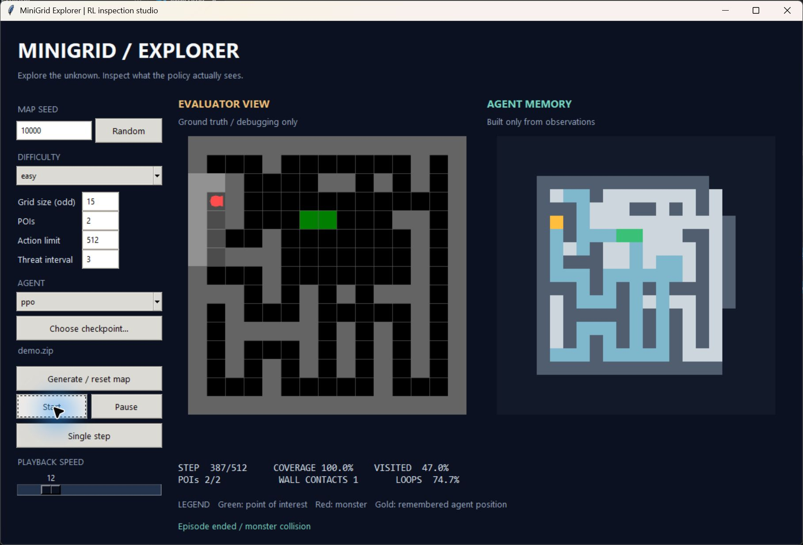

# MiniGrid Explorer

A reproducible reinforcement-learning exploration project built directly on the official Farama MiniGrid repository. A PPO policy explores procedural rooms and corridors using a 7 x 7 partial view and a map reconstructed only from its own observations. A moving patrol makes survival part of the task.

The upstream Git history and MIT license are retained. The original README is in [README.minigrid.md](README.minigrid.md); assignment code is under `exploration/`. The two upstream integration edits add the exploration package/dependencies and explicit UTF-8 reads during Windows installation.



## Try the saved policy

The portable Windows build is `dist/MiniGridExplorer-Windows-CPU.zip`. Extract it and run **Launch UI.bat** or **Smoke test.bat**. Python, CUDA, internet access, and retraining are not needed. The command-line equivalent is:

```powershell
.\MiniGridExplorer.exe smoke --checkpoint .\_internal\checkpoints\demo.zip
.\MiniGridExplorer.exe ui
```

The bundled model's `demo.json` records its selected training step, seed, full configuration, dependencies, observation version, and SHA-256. Consult `submission/manifest.json` for the evidence status. An intermediate package is explicitly labeled preliminary until the full experiment matrix finishes.

## Install from source

Use **Python 3.11** (verified with 3.11.15). Run commands from this repository's root. A complete pinned CPU runtime, including test and artifact tools, is supplied:

```powershell
py -3.11 -m venv .venv
.\.venv\Scripts\python.exe -m pip install -r requirements-cpu.lock.txt
.\.venv\Scripts\python.exe -m exploration smoke --checkpoint checkpoints/demo.zip
.\.venv\Scripts\python.exe -m exploration ui
```

For GPU training, use `requirements-cuda.lock.txt` instead. It pins PyTorch 2.11.0 with CUDA 12.8; the NVIDIA driver must support that runtime. The CPU package is built in a separate environment to exclude CUDA libraries. Other dependency versions are pinned in the corresponding lock file. Linux source execution is supported by the libraries; the delivered native artifact is Windows-specific.

In the original assignment workspace, the prepared GPU and CPU runtimes are in `../.venv` and `../.cpu-venv`, respectively. For example: `..\.venv\Scripts\python.exe -m exploration ui`.

## Environment and agent interface

```python
from exploration.memory import make_env

env = make_env("easy")
observation, info = env.reset(seed=123)
observation, reward, terminated, truncated, info = env.step(2)
env.close()
```

Actions are `0=left`, `1=right`, `2=forward`, `3=wait`. Turn/forward transitions, the grid, wall visibility, observation encoding, and RGB rendering use MiniGrid. No doors, pickup, or combat mechanics are required.

| Preset | Size | POIs | Action budget | Monster period |
|---|---:|---:|---:|---:|
| Easy | 15 x 15 | 2 | 512 | 3 |
| Medium | 21 x 21 | 3 | 1,024 | 2 |
| Hard | 27 x 27 | 5 | 1,536 | 2 |

Map generation carves a connected depth-first maze, rectangular rooms, and sparse extra links. It checks connectivity and reachable placements. Separate seeded streams generate terrain and monster motion. Fixed seed plus actions reproduces an episode. The monster starts at least six traversable steps away, moves orthogonally, and avoids reversing when alternatives exist. It can occupy POIs without destroying them. Agent movement and fatal contact are processed before a scheduled monster move and a second contact check. Death terminates; exhausting the budget truncates. Discovering all POIs does not end exploration.

The raw environment returns MiniGrid's symbolic image, heading, mission, and four feedback values: movement succeeded, wall contact, monster contact, and remaining-budget fraction. The policy wrapper returns:

| Key | Shape | Contents |
|---|---|---|
| `local` | 5 x 7 x 7 | One-hot unseen, empty, wall, POI floor, monster |
| `memory` | 7 x 55 x 55 | Observed mask, walls, floor, discovered POIs, clipped occupancy count, currently visible monsters, agent |
| `scalars` | 8 | Heading one-hot and four feedback values |

All arrays are float32 in [0,1]. Memory coordinates are relative to the start. Mapping consumes only observations, actions, and movement feedback; its class has no environment reference. Occupancy counts include stationary actions and are clipped at ten for policy input. Threat occupancy is cleared on every observation. Static POI discoveries remain remembered. Supported odd grid sizes are 9 through 27. POIs must be 1 through grid size; budgets and monster periods must be positive.

`info` contains only observable reward components. Ground-truth denominators and evaluator statistics are accessed by the evaluator, never inserted into observations. Agents implement `reset(seed)` and `act(observation)` and receive no environment handle.

## Reward and architecture

```text
reward = 0.02 * new_visible_floor
       + 0.01 * first_occupied_cells
       + 1.00 * new_visible_POIs
       - 0.001
       - 0.02 * wall_contact
       - 1.00 * monster_contact
```

Each discovery is credited once per episode using observable history. Reset initializes discovery state without issuing rewards. No reward clipping or running normalization is used. PPO retains its standard advantage normalization. Tests cover repeated turns, waits, revisits, re-sightings, and hidden-map modifications. Legitimately revealing a previously unseen region by turning can earn reward once. Aggressive discovery versus survival and stationary/short-loop behavior remain measurable failure modes; return alone is not a success metric.

The policy uses a local CNN (16/32 channels, 64 output features), a map CNN (32/64/64 stride-two channels, 128 output features), and eight scalar features. Separate actor and critic heads each have two 128-unit layers. The policy is feed-forward; history is represented by the auditable observation-derived map.

## Training

```powershell
python -m exploration train --config configs/pilot.yaml --device cuda
python -m exploration train --config configs/main.yaml --seed 11 --variant main --output runs/main-11
python -m exploration train --config configs/main.yaml --seed 11 --variant main --output runs/main-11 --resume runs/main-11/latest.zip
python -m exploration matrix
```

Do not reuse an existing output folder for a new run. `--resume` treats the configured timesteps as a total target. PPO rounds to a complete rollout. Resume preserves optimizer weights and step count but restarts environment sampling; it is not bitwise continuation. Incompatible observation versions, action/observation spaces, missing sidecars, and invalid checkpoint checksums are rejected.

Default PPO configuration: 16 subprocess environments, 256 steps/environment, batch 256, four epochs, learning rate 0.0003, gamma 0.99, GAE lambda 0.95, clipping 0.2, entropy coefficient 0.01, target KL 0.03, value coefficient 0.5, gradient norm bound 0.5. Training samples Easy and Medium with equal probability. The YAML supports all environment-independent PPO parameters, seed partitions, reward weights, device, worker backend, output folder, and evaluation cadence. UI/`make_env` expose environment parameter overrides.

Run all nine experiments sequentially, with durable logs and interrupted-run recovery:

```powershell
python scripts/run_matrix.py --device cuda
```

This trains `main`, `no_memory`, and `no_novelty` for training seeds 11, 22, and 33 to five million transitions each. No-memory zeros the policy's memory branch while retaining internal reward bookkeeping. No-novelty zeros seen-floor and first-visit rewards. Validation occurs every 250,000 transitions plus the final rollout. The selected checkpoint maximizes validation coverage AUC, then POI discovery, then survival. Validation RNG state is restored so evaluation does not perturb training randomness.

Progress is recorded in `results/full-status.json`; per-run output is under `runs/<variant>-<seed>/`. Each folder contains `config.yaml`, `console.log`, `logs/progress.csv`, TensorBoard events, `training_episodes.csv`, `validation.csv`, validation episode results, `best/latest/final.zip` plus JSON sidecars, and `runtime.json`. Inspect TensorBoard with `tensorboard --logdir runs`.

Run `python scripts/status.py` for a fresh per-run transition count. Training directories are protected by process locks. CUDA subprocess failures retry from the latest saved checkpoint at most twice; the status file records failure if recovery is exhausted.

After every requested run completes, the matrix runner performs held-out evaluation and exports the report, video, and CPU package. It does not tune on held-out results. `--skip-artifacts` stops after evaluation. Use `--tag` with a different value to keep a smaller diagnostic matrix separate from the full study.

## Evaluation and metrics

Committed inclusive seed ranges: training 0-9,999; validation 10,000-10,049; held-out test 20,000-20,099. Training run seeds and environment map seeds serve different roles. The random baseline uses three independent policy seeds; the deterministic frontier baseline runs once per map. All agents receive identical information and budgets. Frontier BFS uses observed floor only, fixed tie-breaking, and visible-threat avoidance; it is a fair strong baseline, not a full-map oracle.

```powershell
python -m exploration evaluate --agents random frontier --split validation --count 10 --output results/baselines
python -m exploration evaluate --agents random frontier ppo --checkpoints runs/main-11/best.zip runs/main-22/best.zip runs/main-33/best.zip --split test --output results/comparison
python -m exploration evaluate --agents ppo --checkpoints runs/main-11/best.zip --split train --count 100 --output results/train-diagnostic
python -m exploration replay --agent ppo --checkpoint checkpoints/demo.zip --seed 10000 --preset medium --output results/replay
```

The full protocol uses all 100 test seeds on Easy, Medium, and Hard. Hard is larger than any training map. A train/test diagnostic uses map seeds from the training partition with the same evaluator; training reward is not substituted for a generalization metric.

| Metric | Definition |
|---|---|
| Revealed coverage | Unique observed traversable cells / true reachable traversable cells |
| Visited coverage | Unique occupied cells / true reachable traversable cells |
| Coverage AUC | Trapezoidal coverage over the full action budget, divided by budget |
| POI discovery | Unique visible POIs, and fraction of generated POIs |
| Survival/completion | Reaches the configured action budget without death |
| Threat interactions | Fatal monster contact count and termination reason |
| Wall contacts | Blocked forward-action count and count / actions |
| Movement efficiency | New occupied cells after reset / actions |
| Repeated-state rate | Fraction returning to a (relative position, heading) seen within 16 actions |
| Loop rate | Repeated state within 16 actions with no new floor or POI discovery |
| Latency | Action selection plus wrapper observation/memory preprocessing; mean, median, p95 |

Coverage/discovery curves hold final values after death through the configured budget, avoiding survivor bias. Engine simulation and rendering are excluded from inference latency. The first action is included. All saved policies are evaluated on CPU with one PyTorch thread; runtime/platform provenance is in the summary.

Episode rows contain their own latency mean, median, and p95. The summary's `inference_step_mean_ms` weights episode means by executed actions to obtain the overall per-step mean; ordinary metric means and deviations describe episodes.

Outputs: `episodes.csv` (every episode), `curves.csv` (every 32 actions plus final budget), `summary.json` (means, episode standard deviations, individual run means, run-mean standard deviations, paired-map bootstrap intervals, seed and checkpoint provenance). Paired comparisons average runs per map before resampling common maps; these intervals quantify map variation, not complete uncertainty across training seeds. A single deterministic run has no invented between-run standard deviation.

The complete submission export also evaluates 100 training-partition seeds and writes `generalization.json`: test-minus-training-partition gaps and Hard-minus-Medium gaps for coverage, AUC, discoveries, and survival. This diagnostic does not imply that every sampled training-partition map was encountered by every training run. Curated training histories and selected checkpoints are exported alongside the results; `checkpoints/index.json` separates selected steps from the completed training budget.

The research goal is improvement over random exploration with meaningful discovery and survival. Results against the stronger frontier baseline are reported honestly. A higher training reward or an attractive selected video alone does not establish learning.

## UI, replay, and submission artifacts

The Tkinter UI exposes seed entry/randomization; preset, size, POI count, action limit and patrol interval; baseline/checkpoint selection; start, pause, reset, selected-agent single-step; speed; and live coverage, visited coverage, POIs, contacts, and loops. Parameter and agent changes apply on reset. The evaluator ground-truth view is clearly labeled and never fed to the policy. All policy inference is CPU-based.

Replay exports `episode.mp4`, `replay.json` with every action and checkpoint checksum, and `final.png`. Playback skips four simulation actions per video frame by default; the complete trace is retained. The two synchronized panels show ground truth and observation-derived memory.

Generate all submission artifacts from actual evaluation files:

```powershell
python scripts/export_submission.py --results results/full --checkpoint runs/main-11/best.zip
```

This creates `submission/technical-report.pdf` (five pages), `demo.mp4` (180 seconds, silent explanatory captions), plots, raw result copies, failure-case selections, replay videos, and `manifest.json`. Incomplete matrices are labeled preliminary. Results are never synthesized. The demo covers the Python UI, procedural maps, baseline and trained behavior, POIs, threat contact, outcome comparisons, and limitations.

For a complete matrix, the exporter also commits only the generated checkpoint/result/submission paths on `assignment/exploration`, then creates `dist/MiniGridExplorer-source.bundle`, a release manifest, and SHA-256 checksums. The source bundle preserves upstream history and can be cloned with Git. Remote publication is a separate step requiring access to `emkienngu123/minigrid-explorer`; the supplied finalizer never pushes or publishes.

Build with a separate CPU-only environment, for example:

```powershell
py -3.11 -m venv ..\.cpu-venv
..\.cpu-venv\Scripts\python.exe -m pip install -r requirements-cpu.lock.txt
..\.cpu-venv\Scripts\python.exe scripts/build_windows.py --checkpoint checkpoints/demo.zip
```

The exporter uses `../.cpu-venv` for its automatic build; `--skip-build` skips that step. PyInstaller outputs a one-folder build and zipped distribution under `dist/`. The build script refuses a CUDA runtime and runs the saved-checkpoint smoke test against the executable. Packaging is Windows-only. The source workflow remains usable without the native artifact.

Matching Tcl/Tk scripts are collected explicitly, so a restricted builder's inability to initialize Tcl cannot silently remove the UI. The frozen smoke test checks that UI modules import as well as loading the saved policy; the built inspector is also checked interactively.

## Tests and checks

```powershell
python -m pytest tests_exploration -q
python -m ruff check exploration tests_exploration scripts
python -m exploration smoke --checkpoint checkpoints/demo.zip
```

The focused suite checks reset/trajectory reproducibility, connected maps and safe placements, native movement/odometry, occlusion, monster timing/walls, both fatal-contact orders, truncation, reward math and one-time discovery, hidden-information invariance, memory reset and threat clearing, fair baseline determinism, seed partitions, AUC after death, run/episode variation, paired comparisons, and checkpoint round trips. Upstream tests remain in `tests/`.

## Limitations and attribution

Exact compass/contact odometry simplifies localization. Only one generator family and patrol rule are implemented. Fixed memory supports map sizes through 27. A deterministic policy may loop despite stochastic training; loop rates and failure replays expose that. GPU training is reproducible within the tested runtime but cross-device bitwise equality is not promised. Selected checkpoints may precede the final five-million-transition budget; completed-run counts and selected checkpoint steps are recorded separately.

See [ATTRIBUTION.md](ATTRIBUTION.md) for upstream revision, library licenses, and research references. Future work includes uncertain odometry, recurrent-policy comparisons, richer map distributions, and tracking beliefs about hidden threats.
