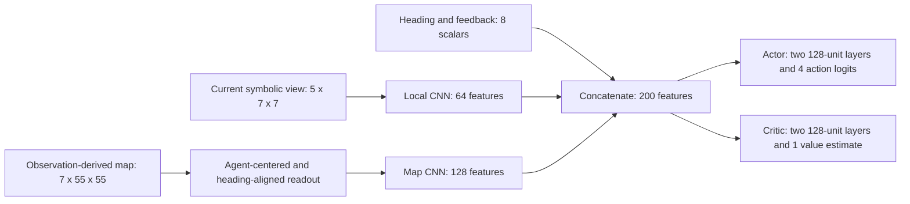

# Architecture motivation and evidence

**Final confirmation update:** the reserved-map study on seeds 40000-40099 confirms 90.8% aligned coverage versus 68.9% original and 78.6% mapless, and completes the aligned reward ablation (59.6% without seen/visit bonuses). See [the current technical report](../submission/final/technical-report.pdf) and [confirmation evidence](../results/aligned-reward-followup/report.md). The investigation narrative below retains the historical 30000-set findings and their development context; the formerly missing reward ablation is now complete.

The design is a practical hypothesis about this task: explicit spatial history, expressed relative to the agent, should make exploration decisions easier to learn from partial observations. It is not a claim that PPO, two CNN branches, or the selected layer widths are universally optimal.

This document separates task-based motivation, engineering choices, and what the experiments actually established. The alignment refinement followed a failed initial result; it should not be presented as if the final representation had been known to work from the outset.

## 1. Task requirements lead to the representation

An observation describes only a wall-occluded 7 x 7 region. Two visits to a visually identical junction can call for different exploration decisions because different branches have already been explored. The immediate view does not explicitly identify that episode history. Local reactive strategies can still explore well, as our mapless baseline demonstrates, but history is a plausible source of further improvement.

The task also separates information at different spatial extents:

- Nearby walls and currently visible monsters affect immediate movement.
- Previously observed passages, POIs, and visits help identify where further exploration may be useful.
- Remaining time changes the value of taking a longer route in a finite episode.

We therefore give the policy current perception, an observation-derived map, and scalar feedback. This is an augmented partial observation, not the complete simulator state or an exact belief over hidden threats.

## 2. Why symbolic observations and explicit map memory?

MiniGrid already supplies symbolic object identities. One-hot tile channels represent categories without implying that numeric object IDs have meaningful ordinal distances. They also express spatial adjacency directly and avoid introducing an image-recognition problem that this assignment does not require. An RGB-policy comparison has not been performed.

Deterministic movement and movement-success feedback make relative odometry available. We exploit those signals to reconstruct observed terrain, rather than requiring a recurrent network to learn both map reconstruction and control from rewards. The map can be inspected, reset, audited for hidden-information access, and shared with the frontier baseline. These are engineering and interpretability advantages; they do not prove superiority over learned recurrent memory.

Map channels have distinct roles: observed/unknown distinguishes lack of evidence from known floor; walls/floor encode traversability; discovered POIs record task progress; occupancy counts summarize revisits; the agent marker provides pose; the monster channel describes only current visibility. Old monster locations are cleared because a past sighting is not evidence of current occupancy. We do not maintain a distribution over unseen monster positions, which limits threat prediction.

The 55 x 55 canvas has radius 27 around its center, giving a safe fixed allocation for the supported maps up to 27 cells wide. It provides a simple shared observation shape across presets. It is a geometric bound and implementation convenience, not an experimentally optimized memory size. The stored map is start-relative; the aligned policy reads a translated/rotated view of that same storage.

## 3. Why agent-centered, heading-aligned map input?

Actions are relative to the agent: turn left, turn right, forward, and wait. In the original map input, the current pose moved across the canvas while orientation was supplied separately. The network had to infer which map features were ahead, behind, or to the side before selecting one of those relative actions.

The refinement uses the already-observable pose marker and heading to place the agent at the center with forward upward. It applies the same integer-coordinate transformation to every channel and preserves relevant observed terrain. This supplies a useful inductive bias: the same relative obstacle or corridor geometry has a consistent placement and orientation at the map-CNN input. It does not supply routes, frontiers, hidden tiles, or hidden threats.

This hypothesis was motivated by the initial memory failure and diagnostics, then tested by retraining with the same CNN architecture, rewards, and interaction budget. On fresh test seeds, mean revealed coverage was 89.2% with alignment, 68.5% with the original map, and 78.6% without map input. Aligned versus original is the cleaner representation comparison because both have active map encoders. Aligned versus mapless additionally changes the information presented and the effective optimization problem.

These results support alignment as a useful design choice in this setting. They do not establish that it removes all navigation difficulties: Hard coverage remains below frontier and greedy stalls remain. No learned layer or trainable parameter was added by alignment.

## 4. Why two CNN branches and scalar concatenation?

The local and map inputs have different spatial extents and semantics, although each source cell represents a grid tile. Separate encoders let the local branch retain immediate tile detail without strided downsampling, while the map branch reduces a larger historical context before fusion. Convolution shares filters across recurring local patterns such as walls, corridor segments, and junctions. Its suitability for spatial input is the motivation; superiority over an MLP or a single fused encoder has not been tested.

Eight scalar features enter directly because heading, feedback, and remaining time are not images. Absolute heading was especially relevant to the original world-oriented readout and is retained in the aligned experiment to hold other inputs fixed. Whether it remains useful after alignment is an open ablation, not an established requirement.

The two encoders are shared between the actor and critic. Their separate MLP heads produce different outputs: action probabilities and expected discounted return. Sharing the spatial features avoids duplicating the entire perception stack; it may also create gradient interference, which has not been isolated experimentally.

The exact channel counts, feature dimensions, striding schedule, and two-layer 128-unit heads are engineering defaults, not outcomes of architecture search. Their adequacy is supported by an executable trained system, 649,925 total parameters, and approximately 1.20 ms isolated CPU action-plus-preprocessing latency. The 459,008-parameter map encoder is still a substantial cost. These measurements support feasibility, not minimality or optimal capacity.

The map CNN is a feature extractor, not an explicit graph-search planner. Calling it a global planner would overstate what is implemented and proven.

## 5. Why PPO?

PPO was selected as a practical discrete-action actor-critic baseline with a mature implementation, dictionary-observation/custom-encoder support, parallel rollout collection, and standard logging/checkpoint facilities. Its clipped surrogate limits incentives for some large probability-ratio changes; our target-KL stopping and gradient clipping provide additional controls. They do not guarantee stable learning, as the initial memory configuration's late validation regression demonstrated.

The original PPO paper motivates an interaction-and-minibatch-update procedure with a comparatively straightforward implementation. It does not establish that PPO is the best algorithm for this environment. [Schulman et al., Proximal Policy Optimization Algorithms](https://arxiv.org/abs/1707.06347).

Our evidence establishes that PPO can learn useful exploration under the selected representation and reward, with repeated runs and separate validation/test evaluation. DQN or another algorithm would strengthen an algorithm-comparison claim, but would not by itself establish why two encoders or these layer widths are necessary.

As a later engineering observation, PPO's short rollout storage also avoids the large persistent replay allocation implied by dense float32 map observations. The DQN review calculated about 16 GiB for observations plus next observations at 100,000 transitions with the current layout. This was quantified after the initial architecture choice and should not be represented as an original experimental reason to reject DQN.

## 6. Claim-to-evidence map

| Design claim | Existing support | Limit or missing comparison |
|---|---|---|
| Observation history can help exploration | Aligned map beats independently trained mapless PPO on fresh maps | Original map underperformed mapless PPO; history alone is not sufficient |
| Relative map geometry is easier for this policy to use | Aligned versus original map retains architecture/rewards; coverage gains hold across presets | Three training seeds; no universal claim about other encoders or tasks |
| Exploration bonuses encourage useful coverage | Legacy no-seen/visit-bonus ablation performs poorly | An aligned no-bonus model has not been trained |
| The chosen system is computationally feasible | Completed training, saved-model loading, CPU inference measurements | Does not show that this encoder is the smallest or fastest adequate design |
| Two input branches are appropriate | Task-based separation of immediate perception and spatial history | No single-encoder or local-branch-removal ablation |
| Explicit memory is preferable to recurrence for this submission's implementation goals | Observable odometry, inspectable map, deterministic mapping tests, reusable fair baseline interface | No recurrent-policy comparison; hidden threat history is incompletely represented |
| PPO is a suitable practical baseline | Three aligned runs, strong random-baseline improvement, held-out generalization | No algorithm comparison establishing PPO superiority |

The most defensible conclusion is: this architecture is task-motivated and experimentally useful, with particularly strong evidence for the map readout. Exact capacity and several architectural components remain engineering choices with documented limitations.

## 7. Report-ready rationale

> The task combines immediate collision and threat decisions with history-dependent exploration. We therefore represent the current symbolic view and an observation-derived spatial map separately. Exact movement feedback permits inspectable relative mapping without requiring the policy to learn localization from reward. Separate CNN branches process immediate tile geometry and wider exploration history, while heading, feedback, and remaining time enter as scalars. The policy reads memory in an agent-centered, heading-aligned frame so map features correspond consistently to relative actions. PPO supplies a practical discrete actor-critic training pipeline; separate actor and critic heads share the encoded observations. Layer widths and the fixed canvas are engineering choices whose feasibility is measured, rather than claimed optimal. The initial start-relative map underperformed a mapless policy, motivating the alignment experiment. Fresh held-out evaluation subsequently supported the refinement while retaining the same network size. Remaining Hard-map, survival, and looping failures delimit the result; PPO and the dual-encoder design have not been shown superior to all alternatives.

## Sources and context

- [Implementation](../exploration/policy.py) and [observation/memory interface](../exploration/memory.py).
- [Frozen fresh-test comparison, uncertainty, and latency](../results/memory-alignment-comparison/report.md).
- [Initial memory investigation](../results/memory-investigation/report.md).
- [PPO paper](https://arxiv.org/abs/1707.06347): algorithmic background, not evidence of superiority in this task.
- [Active Neural SLAM](https://arxiv.org/abs/2004.05155): related motivation for separating mapping and navigation. That system uses learned SLAM, global/local policies, and analytic planning; our simpler observation-derived mapper and direct-action policy do not implement that architecture.
- [SB3 custom policies](https://stable-baselines3.readthedocs.io/en/master/guide/custom_policy.html): implementation interface, not an empirical architecture justification.
