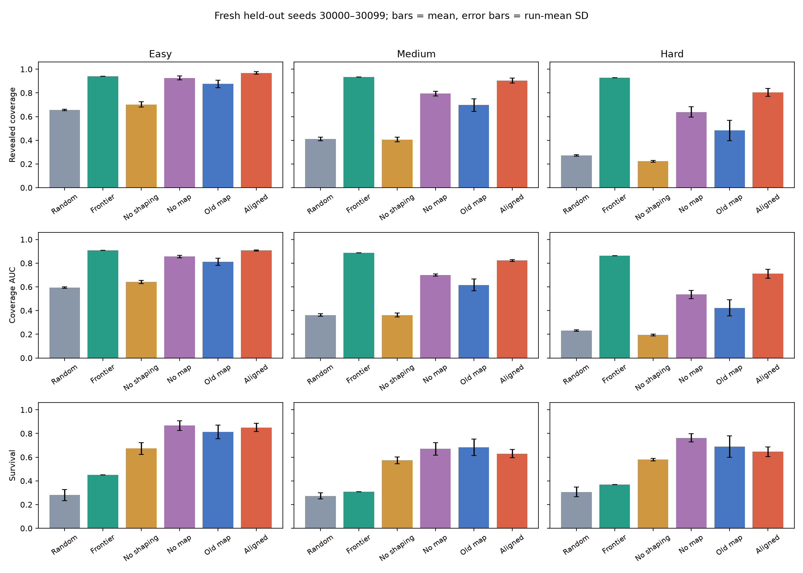
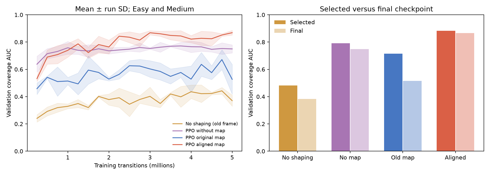
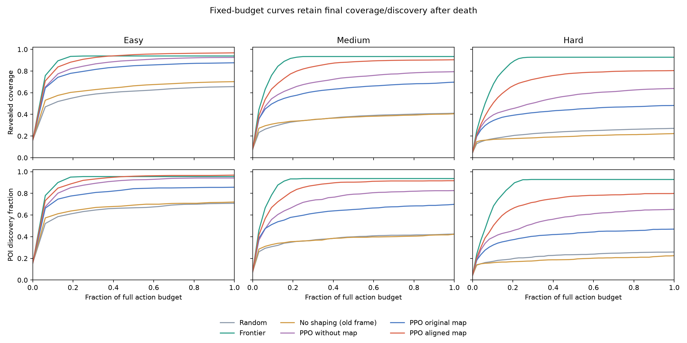
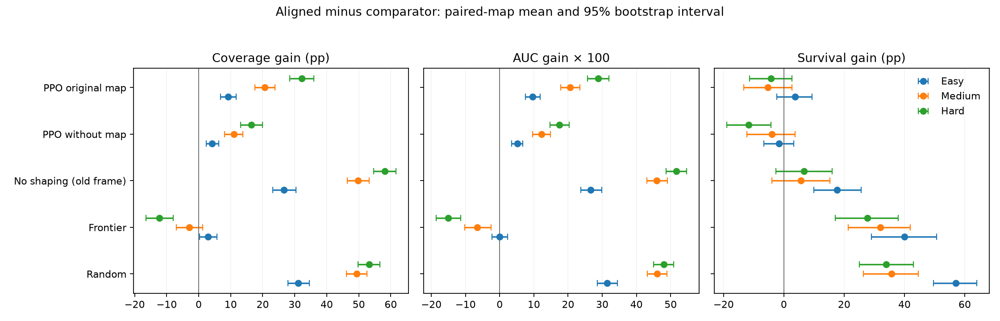
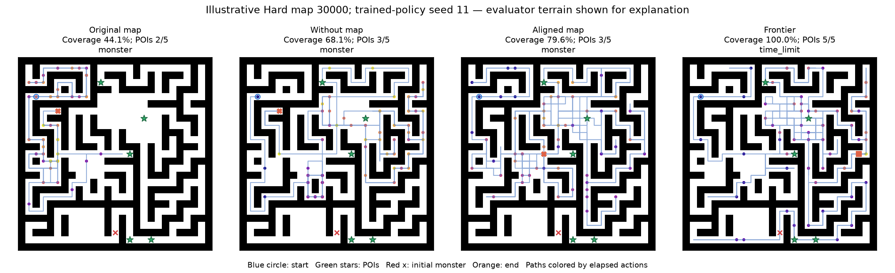

# Memory alignment: full results and comparison

Primary results use fresh held-out map seeds **30000–30099**, all three presets, and frozen validation-selected checkpoints. The original test set (20000–20099) informed the earlier investigation and is not reused as the primary confirmation set.

## Findings and interpretation

**The alignment redesign makes memory useful for this PPO agent.** Mean coverage rises from 68.5% with the original map to 89.2% with the aligned map, a gain of 20.7 percentage points. It also exceeds the mapless PPO by 10.6 points. This is a representation change using the same 649,925-parameter network and observation-derived information, not additional hidden-map access or a recurrent policy.

The gain includes actual movement: visited coverage is 63.3%, versus 48.1% without map input and 36.2% with the original map. POI discovery rises to 89.5%, versus 80.6% and 67.5%, respectively. Because POIs are placed across traversable terrain, discovery gains largely track better coverage; these results do not establish a specialized hidden-POI search strategy.

**The gains are consistent across presets and robust to the resumed reference run.** Paired-map intervals for coverage and AUC improvements over both original-map and mapless PPO remain above zero on all three presets. Excluding the original seed-33 run that resumed after a CUDA failure still gives coverage gains over original memory of +8.2 / +18.7 / +25.4 percentage points (Easy / Medium / Hard). These intervals condition on the trained runs; only three training seeds were tested.

**Frontier remains the strongest overall exploration reference.** It reaches 93.4% mean coverage and 0.886 AUC, versus 89.2% and 0.814 for aligned PPO. Aligned PPO has a modest Easy endpoint-coverage advantage, while Easy AUC is effectively tied. Medium endpoint uncertainty overlaps zero; Medium AUC and both Hard exploration metrics favor frontier. Thus the redesign improves the learned policy substantially without establishing overall superiority to the deterministic explorer.

**Survival is a tradeoff.** Aligned PPO survives 70.9% of episodes versus 37.7% for frontier, but mapless PPO survives 76.7%. On Hard, aligned survival is 64.7% versus 76.3% without map input: -11.7 pp, with a paired-map interval [-19.0, -4.3]. It would be incorrect to describe alignment as improving safety across all PPO comparisons.

**Loops and blocked movement remain weaknesses.** Overall loop rate falls from 45.7% to 41.4%, but remains above mapless PPO's 32.4%. On Hard it is 49.7%, versus 46.5% for original memory. Wall contacts occur on 1.6% of all actions, versus 0.5% without map input. More forward movement changes exposure, so this per-all-actions rate does not isolate wall-avoidance accuracy per forward attempt.

Rare severe stalls remain: on Hard map 30029, training seed 11, aligned PPO survived the entire budget but revealed only 10.0% of the map and recorded a 99.9% loop rate. This is a post-hoc failure example, not typical performance. It shows why survival, mean coverage, and qualitative failures must be reported together.

**Training is more stable, while Hard remains an extrapolation challenge.** Mean selected/final validation AUC is 0.883/0.867, compared with 0.715/0.515 for original memory. Validation covers Easy and Medium only: the comparable fresh-test Easy/Medium AUC is 0.865; the 0.814 three-preset score also includes Hard. Hard coverage drops 10.0 pp from Medium, versus 21.5 pp for the original map. The remaining gap cannot be attributed to spatial extrapolation alone without another controlled experiment.

**The reward ablation is informative but incomplete.** The legacy no-seen/visit-bonus policy averages 44.4% coverage, close to random's 44.6%, and loops on 85.2% of actions. It retains POI and survival-related rewards. Its comparison with original-map PPO supports exploration shaping in that frame; an aligned no-bonus model has not been trained, so the interaction with alignment remains unmeasured.

**Alignment has a measurable CPU cost without extra trainable capacity.** Isolated mean inference plus input preprocessing is 1.204 ms, versus 0.884 ms for original memory and 0.891 ms without map input. The map encoder remains 459,008 parameters. A smaller encoder is a justified next isolated experiment, not an improvement already demonstrated here.

**Practical conclusion:** retain aligned memory as the strongest learned exploration baseline tested here. Keep frontier as the stronger aggregate exploration reference, and retain mapless PPO as a survival reference. Further work should test a compact aligned representation separately and address incomplete-coverage loops and threat interactions. Sampled action selection has not been evaluated for the redesigned model in this comparison. These test maps are now observed; further model selection should use validation and reserve a new confirmation set.

## Protocol and evidence

- **4,800 primary episodes**: each PPO variant uses three training seeds × 100 maps × three presets; random uses three policy seeds; frontier runs once per map.
- Same partial observations, budgets, monster rules, and map seeds for all agents. PPO and frontier use greedy/deterministic actions. No new training or tuning was performed on these fresh test results.
- Checkpoints were selected before testing by validation coverage AUC, then discovery, then survival. Each PPO training run completed approximately five million transitions.
- Fixed-budget curves preserve coverage/discovery after death. Primary evaluation ran four CPU processes, each with one PyTorch thread; isolated latency was measured separately in one process.
- Uncertainty separates episode variation, variation between three trained runs, and paired-map bootstrap intervals. Intervals condition on the trained models and are not multiplicity-corrected.
- A further **450 new aligned episodes** assess 50 training-partition seeds; legacy diagnostics are filtered to those same seeds. These maps are not guaranteed to have been encountered during training.

## Primary revealed coverage

Means ± SD of the three run means (percentage points). Random variation is across policy seeds; frontier has one deterministic run per map.

| Agent | Easy | Medium | Hard |
|---|---:|---:|---:|
| Random | 65.6% ± 0.6 | 41.1% ± 1.4 | 27.1% ± 0.6 |
| Frontier | 93.9% | 93.4% | 92.7% |
| No shaping (old frame) | 70.2% ± 2.3 | 40.6% ± 2.0 | 22.3% ± 0.8 |
| PPO without map | 92.6% ± 1.7 | 79.4% ± 2.0 | 63.9% ± 4.3 |
| PPO original map | 87.6% ± 3.2 | 69.8% ± 5.3 | 48.2% ± 8.5 |
| PPO aligned map | 96.8% ± 1.1 | 90.4% ± 2.0 | 80.4% ± 3.4 |

## Overall comparison

Easy, Medium, and Hard receive equal weight. POI values are fractions of each map's configured count.

| Agent | Coverage | Visited | AUC | POIs | Survival | Loop rate | New visited / 100 actions |
|---|---:|---:|---:|---:|---:|---:|---:|
| Random | 44.6% | 11.2% | 0.396 | 46.4% | 28.7% | 68.1% | 5.98 |
| Frontier | 93.4% | 60.8% | 0.886 | 94.0% | 37.7% | 21.0% | 32.33 |
| No shaping (old frame) | 44.4% | 10.5% | 0.399 | 45.6% | 60.9% | 85.2% | 3.78 |
| PPO without map | 78.6% | 48.1% | 0.697 | 80.6% | 76.7% | 32.4% | 13.85 |
| PPO original map | 68.5% | 36.2% | 0.617 | 67.5% | 72.9% | 45.7% | 10.72 |
| PPO aligned map | 89.2% | 63.3% | 0.814 | 89.5% | 70.9% | 41.4% | 19.65 |

## Complete per-preset metrics

### Easy

| Agent | Visited | AUC | POIs found | POI fraction | Survival | Wall contacts / 100 actions | Loops | Repeated states |
|---|---:|---:|---:|---:|---:|---:|---:|---:|
| Random | 14.3% | 0.594 | 1.42 | 70.8% | 28.0% | 10.35 | 66.7% | 66.7% |
| Frontier | 64.9% | 0.909 | 1.91 | 95.5% | 45.0% | 0.00 | 17.7% | 17.7% |
| No shaping (old frame) | 17.4% | 0.641 | 1.44 | 72.0% | 67.3% | 0.42 | 79.9% | 79.9% |
| PPO without map | 61.6% | 0.856 | 1.88 | 94.2% | 86.7% | 0.29 | 30.7% | 30.7% |
| PPO original map | 48.5% | 0.811 | 1.71 | 85.7% | 81.3% | 0.24 | 44.1% | 44.1% |
| PPO aligned map | 75.6% | 0.908 | 1.94 | 96.8% | 85.0% | 0.95 | 35.6% | 35.6% |

### Medium

| Agent | Visited | AUC | POIs found | POI fraction | Survival | Wall contacts / 100 actions | Loops | Repeated states |
|---|---:|---:|---:|---:|---:|---:|---:|---:|
| Random | 11.2% | 0.362 | 1.27 | 42.4% | 27.3% | 11.03 | 68.4% | 68.4% |
| Frontier | 60.6% | 0.887 | 2.81 | 93.7% | 31.0% | 0.00 | 20.3% | 20.3% |
| No shaping (old frame) | 9.1% | 0.363 | 1.27 | 42.3% | 57.3% | 0.53 | 86.6% | 86.6% |
| PPO without map | 46.5% | 0.700 | 2.48 | 82.6% | 67.0% | 0.45 | 31.8% | 31.8% |
| PPO original map | 35.7% | 0.616 | 2.10 | 69.9% | 68.3% | 0.41 | 46.4% | 46.4% |
| PPO aligned map | 64.4% | 0.822 | 2.75 | 91.7% | 63.0% | 1.26 | 38.7% | 38.7% |

### Hard

| Agent | Visited | AUC | POIs found | POI fraction | Survival | Wall contacts / 100 actions | Loops | Repeated states |
|---|---:|---:|---:|---:|---:|---:|---:|---:|
| Random | 8.2% | 0.231 | 1.29 | 25.9% | 30.7% | 11.42 | 69.3% | 69.3% |
| Frontier | 56.8% | 0.862 | 4.64 | 92.8% | 37.0% | 0.00 | 25.0% | 25.0% |
| No shaping (old frame) | 4.9% | 0.194 | 1.12 | 22.5% | 58.0% | 1.09 | 89.2% | 89.2% |
| PPO without map | 36.3% | 0.536 | 3.26 | 65.2% | 76.3% | 0.66 | 34.6% | 34.6% |
| PPO original map | 24.5% | 0.423 | 2.35 | 47.0% | 69.0% | 1.28 | 46.5% | 46.5% |
| PPO aligned map | 49.9% | 0.711 | 4.00 | 79.9% | 64.7% | 2.48 | 49.7% | 49.7% |

## Paired comparisons

Aligned minus comparator; mean differences and 95% map-bootstrap intervals. Coverage and survival use percentage points. AUC remains on its 0–1 scale.

| Preset | Comparator | Coverage difference [95% CI] | AUC difference [95% CI] | Survival difference [95% CI] |
|---|---|---:|---:|---:|
| Easy | Random | +31.2 [+27.9, +34.6] | +0.314 [+0.285, +0.344] | +57.0 [+49.7, +64.0] |
| Easy | Frontier | +2.9 [+0.3, +5.7] | -0.001 [-0.023, +0.024] | +40.0 [+29.0, +50.7] |
| Easy | No shaping (old frame) | +26.6 [+23.1, +30.4] | +0.267 [+0.237, +0.298] | +17.7 [+10.0, +25.7] |
| Easy | PPO without map | +4.2 [+2.4, +6.2] | +0.051 [+0.035, +0.068] | -1.7 [-6.7, +3.3] |
| Easy | PPO original map | +9.2 [+6.9, +11.6] | +0.096 [+0.076, +0.118] | +3.7 [-2.3, +9.3] |
| Medium | Random | +49.4 [+46.1, +52.6] | +0.460 [+0.431, +0.489] | +35.7 [+26.3, +44.7] |
| Medium | Frontier | -3.0 [-7.0, +1.3] | -0.065 [-0.102, -0.026] | +32.0 [+21.3, +42.0] |
| Medium | No shaping (old frame) | +49.8 [+46.5, +53.3] | +0.460 [+0.430, +0.490] | +5.7 [-4.0, +15.3] |
| Medium | PPO without map | +11.0 [+8.1, +13.8] | +0.122 [+0.096, +0.148] | -4.0 [-12.3, +3.7] |
| Medium | PPO original map | +20.6 [+17.5, +23.8] | +0.206 [+0.179, +0.234] | -5.3 [-13.3, +2.7] |
| Hard | Random | +53.3 [+49.8, +56.7] | +0.480 [+0.451, +0.508] | +34.0 [+25.0, +43.0] |
| Hard | Frontier | -12.3 [-16.5, -8.0] | -0.151 [-0.186, -0.114] | +27.7 [+17.0, +38.0] |
| Hard | No shaping (old frame) | +58.1 [+54.6, +61.7] | +0.516 [+0.487, +0.546] | +6.7 [-2.7, +16.0] |
| Hard | PPO without map | +16.5 [+13.1, +19.9] | +0.175 [+0.147, +0.203] | -11.7 [-19.0, -4.3] |
| Hard | PPO original map | +32.2 [+28.4, +36.0] | +0.288 [+0.256, +0.320] | -4.3 [-11.3, +2.7] |

The sensitivity comparison using only matched training seeds 11 and 22 is stored in `summary.json`; it excludes the original memory run that resumed after a CUDA failure.

## Learning, selection, and stability

| Policy | Mean selected validation AUC | Mean final validation AUC | Selected training steps (seeds 11 / 22 / 33) |
|---|---:|---:|---|
| No shaping (old frame) | 0.482 | 0.384 | 4M / 4.25M / 3.75M |
| PPO without map | 0.791 | 0.748 | 1M / 1M / 4M |
| PPO original map | 0.715 | 0.515 | 4.25M / 4.75M / 3M |
| PPO aligned map | 0.883 | 0.867 | 3.25M / 4.5M / 3.75M |

Last logged entropy, KL, critic loss, and explained variance are available in `optimization-diagnostics.csv`. They describe each policy's own training distribution and are auxiliary diagnostics, not substitutes for test performance.

## Generalization

| Agent | Fresh test minus training-partition coverage: Easy / Medium / Hard (pp) | Hard minus Medium coverage (pp) |
|---|---|---:|
| Random | +3.6 / +1.5 / -0.5 | -14.0 |
| Frontier | -4.6 / +4.2 / +3.3 | -0.7 |
| No shaping (old frame) | +5.4 / -0.5 / -1.4 | -18.3 |
| PPO without map | +0.1 / -0.5 / -2.1 | -15.5 |
| PPO original map | -0.9 / -3.0 / -1.0 | -21.5 |
| PPO aligned map | -1.2 / -1.6 / -0.7 | -10.0 |

Hard is a joint extrapolation in map size, POI count, action budget, and agent-relative spatial extent. A Hard drop alone does not identify which factor causes it. For Hard, the training-partition diagnostic refers only to seed numbers: Hard maps were never used for training.

## Isolated CPU inference latency

Includes action selection plus observation/memory preprocessing for the observation used. Excludes environment physics, rendering, and model loading. Two shared validation maps per preset, all three policy/training seeds; 96 episodes total. First action included.

| Agent | Actions sampled | Mean (ms) | Median (ms) | p95 (ms) |
|---|---:|---:|---:|---:|
| Random | 13272 | 0.052 | 0.047 | 0.080 |
| Frontier | 3677 | 0.523 | 0.529 | 0.869 |
| No shaping (old frame) | 16143 | 0.889 | 0.858 | 1.064 |
| PPO without map | 15746 | 0.891 | 0.855 | 1.071 |
| PPO original map | 16744 | 0.884 | 0.851 | 1.063 |
| PPO aligned map | 15966 | 1.204 | 1.164 | 1.427 |

All PPO variants have the same trainable parameter count; alignment adds an integer-coordinate readout before the map CNN. The no-map variant's zero-input branch is inactive, so its effective optimization problem differs. Parameter counts are recorded in `isolated-latency.json`.

## Interpretation limits

- The original-map versus aligned-map comparison isolates the intended representation change while retaining architecture, rewards, interaction budget, and selection rule. Three seeds provide limited evidence about training-seed uncertainty.
- The no-shaping model uses the original map frame. It is a legacy reward ablation, not an aligned-map reward ablation; it cannot isolate the reward contribution in the redesigned system.
- A high loop rate can include revisiting after most of a map is already revealed. Interpret it jointly with coverage curves and incomplete-coverage failure cases.
- Coverage retained after death credits information gathered before contact. Survival is therefore reported separately; frontier coverage alone does not establish safer behavior.
- Training wall times came from different sessions/load conditions. They are observed costs, not a controlled claim that alignment accelerates training.
- Historical submission artifacts were checksum-verified unchanged. No model was selected or tuned using these new test results.

## Figures

## Files and reproducibility

- `protocol.json`: frozen checkpoint hashes, map split, inference settings, and original-artifact checksums.
- `episodes.csv`, `curves.csv`: all primary raw measurements; `aggregate-metrics.csv`: complete metric means, episode SDs, run SDs, and percentiles.
- `summary.json`: paired intervals, run-level results, learning histories, and seed-11/22 sensitivity.
- `selected-checkpoints.csv`, `training/`: selected steps, validation histories, configuration, training logs, and recorded runtimes.
- `generalization.json`, `training-partition/`: matched training-partition diagnostic.
- `isolated-latency.json`, `isolated-latency-samples.csv`: independent CPU latency measurements.
- `failure-cases.json`, `qualitative/`: failures and fixed-map action traces; the illustrated map is Hard seed 30000 with training seed 11, not a claim of typical behavior.

Reproduction scripts are archived in `reproduction/` and locate the project root from their checkout location. Run the primary evaluator first, then the finishing pipeline. Existing completed parts are reused only when the frozen checkpoint/protocol manifest matches. Raw episode timings from parallel workers are not used as isolated latency estimates.
